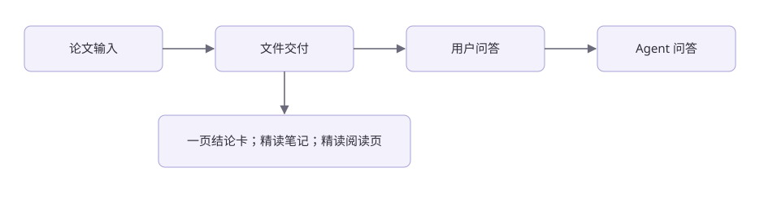

# paper-tutor · 文献精读、用户问答与 Agent 问答

> 一个自包含的 Agent Skill：把一篇论文读成**可追溯的证据**，再做成**逐段对照的精读网页**，最后用它陪你做用户问答与 Agent 问答。
> 遵循 Agent Skills 规范（`SKILL.md` + YAML frontmatter），DSH、Claude Code、Codex 等宿主都能直接加载。
> Claude Code 用户可直接从插件市场安装：`/plugin install paper-tutor --marketplace SeasonRain1807/paper-tutor`。


-brightgreen)


---

## 使用

在会话里直接说：

> 帮我把这篇 paper.pdf 精读一遍

Skill 会自动加载（触发条件写在 `SKILL.md` 的 `description` 里：提供论文并要求深读、逐段精读，或做用户问答、Agent 问答）。

## Skill 工作流

读论文的难点通常不是生词，而是**论证被摊平在一整篇里**：主张在引言、证据在结果、限定在讨论，读者得自己在中间来回跳。
paper-tutor 把「读一篇论文」拆成四步，全部由这一个 Skill 完成，**不调用、也不依赖任何其它 skill**：



流程图（`docs/stage-flow.svg`）表达的是四个方框、一条主干、一条支线，白话讲是：

1. **论文输入** —— 你给出 PDF / HTML / DOCX 或一个 DOI，skill 被触发
2. **文件交付** —— Agent 精读，产出三份文件：一页结论卡.md、精读笔记.md、精读阅读页.html
3. **用户问答** —— 用户提问，Agent 先在原文里定位页码/图表/章节，再按「直接回答 → 证据 → 证据性质 → 替代解释」回答
4. **Agent 问答** —— Agent 出题：一次只问一题，你答完它判卷、纠错、再推进；中途可用 `/提示`、`/答案`、`/跳过`、`/下一题` 控制节奏

> `/提示` 这类写法是 skill 内部的消息约定。如果宿主把 `/` 开头当斜杠命令（Claude Code、Codex 的命令菜单），换成同一句话的自然语言即可，例如「给点提示」「跳过这题」。

## 交付内容简介

| 文件 | 内容 | 模板 |
|---|---|---|
| `1_一页结论卡.md` | 一句话读懂、30秒快速判断、最关键数据、核心机制、对我的科研有什么用、最值得保存的图 | `templates/1_一页结论卡模板.md` |
| `2_精读笔记.md` | YAML 文献信息、研究背景、结果与讨论（逐图表解释、实验方法、结论与机制）、不足与思考（创新性、外推、局限、补验证、学术表达、新问题、课题启发） | `templates/2_精读笔记模板.md` |
| `3_精读阅读页.html` | 逐段卡片：左栏上原文下译文、右栏三段式注释；论证地图、目录、搜索、原图放大；单文件离线 | `templates/3_精读阅读页.html` |
| `4_待确认信息.md` | 仅在信息缺失、需要用户补充时生成 | — |

## 目录结构

```text
.
├── README.md
├── LICENSE
├── .claude-plugin/
│   └── marketplace.json                 # Claude Code 插件市场清单（插件 source 指向仓库根）
├── install.ps1                          # Windows 一键安装（junction / 复制）
├── install.sh                           # macOS / Linux 一键安装（symlink / 复制）
├── docs/
│   └── stage-flow.svg                   # 阶段流程图
└── skills/
    └── paper-tutor/                     # ← skill 本体（宿主中立），各宿主链接或复制这个目录
        ├── SKILL.md                     # 主流程
        ├── references/                  # 12 份细则：数据契约、翻译规则、注释量表、质量门、图片规则…
        ├── scripts/
        │   ├── extract.py               # 论文 → source.txt（逐字基准）
        │   ├── check.py                 # data.json 校验：结构 / 逐字 / 覆盖 / 图片字节
        │   ├── build.py                 # data.json → 3_精读阅读页.html（单文件离线）
        │   ├── validate_output.py       # 交付前结构检查：1_/2_ 两份笔记
        │   └── common.py                # 公共工具：规范化、哈希、数据加载
        └── templates/
            ├── 1_一页结论卡模板.md
            ├── 2_精读笔记模板.md
            ├── 3_精读阅读页.html        # 成品示例（12 段演示论文，可直接打开）
            ├── page/reading.css|js      # 页面样式与交互，构建时内联
            └── 精读示例/                # 演示数据：source.txt / data.json / figures/
```

`install.ps1` / `install.sh` 只是在你自己的项目里建链接，不会改动这个仓库。

## 兼容性

| 宿主 | 项目级目录 | 用户级目录 | 备注 |
|---|---|---|---|
| DeepSeek Harness（DSH） | `.dsh/skills/paper-tutor/` | — | 仅项目级；用 `install.ps1 -Hosts dsh` 把仓库里的 `skills/paper-tutor/` 链过去 |
| Claude Code | `.claude/skills/paper-tutor/` | `~/.claude/skills/paper-tutor/` | 可用 `${CLAUDE_SKILL_DIR}` 变量指代 skill 目录 |
| Codex | `.codex/skills/paper-tutor/` | `~/.codex/skills/paper-tutor/` | `$CODEX_HOME` 优先；部分版本也索引 `.agents/skills/` |
| 其它 Agent Skills 宿主 | `.agents/skills/paper-tutor/` | `~/.agents/skills/paper-tutor/` | 通用约定目录 |

Skill 本体只有三样东西，且都可移植：`SKILL.md`（frontmatter + 正文）、`references/`、`scripts/` + `templates/`。
脚本只用 Python 标准库，不含任何宿主专属 API 或环境变量；各宿主的差别只在**目录约定**——把 skill 放到对应目录，它就能加载。目录由 `install.ps1` / `install.sh` 替你摆好。

表里的宿主目录（如 `.dsh/skills/paper-tutor/`、`.claude/skills/paper-tutor/`）都是**安装位**：脚本建的链接或副本，已被 `.gitignore` 忽略。仓库里只有 `skills/paper-tutor/` 这一份真身，clone 下来不会自带任何宿主目录。

## 安装

按你的宿主选一条即可。仓库是**宿主中立**布局：skill 本体在 `skills/paper-tutor/`，仓库根同时充当 Claude Code 的插件市场根与插件根。

### Claude Code

在 Claude Code 会话里一条命令（v2.1.275+）：

```text
/plugin install paper-tutor --marketplace SeasonRain1807/paper-tutor
```

Claude Code 会先让你确认市场来源，然后打开插件详情，选好安装 scope（user / project / local）即可。

老版本或多跑一步也行：

```text
/plugin marketplace add SeasonRain1807/paper-tutor
/plugin install paper-tutor@paper-tutor
```

不等会话、直接在终端装（v2.1.292+）：

```bash
claude plugin install paper-tutor --marketplace SeasonRain1807/paper-tutor
```

装完在**任何项目**里都能用，说一句「帮我把这篇 paper.pdf 精读一遍」就会触发。更新：

```bash
claude plugin marketplace update paper-tutor
claude plugin update paper-tutor@paper-tutor
```

机制：`.claude-plugin/marketplace.json` 里插件条目的 `"source": "./"` 指向仓库根，而仓库根同时是插件根，所以 Claude Code 按标准布局直接加载根下的 `skills/paper-tutor/`（仓库不放 `plugin.json` 时，市场条目本身就是清单）。

只想先试试、不注册市场：

```bash
git clone https://github.com/SeasonRain1807/paper-tutor.git
claude --plugin-dir ./paper-tutor
```

### Codex

Codex 没有插件市场，把 skill 目录放进它的 skills 目录即可（设了 `$CODEX_HOME` 就用 `$CODEX_HOME/skills`，否则 `~/.codex/skills`）：

```bash
git clone https://github.com/SeasonRain1807/paper-tutor.git
mkdir -p ~/.codex/skills
cp -R paper-tutor/skills/paper-tutor ~/.codex/skills/paper-tutor
```

```powershell
git clone https://github.com/SeasonRain1807/paper-tutor.git
New-Item -ItemType Directory -Force "$HOME\.codex\skills" | Out-Null
Copy-Item -Recurse .\paper-tutor\skills\paper-tutor "$HOME\.codex\skills\paper-tutor"
```

只对单个项目生效，就放到该项目下的 `.codex/skills/paper-tutor/`。

### 一键脚本

```bash
git clone https://github.com/SeasonRain1807/paper-tutor.git
cd paper-tutor
```

Windows PowerShell：

```powershell
.\install.ps1                        # 链接到本仓库目录的 Claude Code + Codex（-Target 指定别的项目）
.\install.ps1 -Hosts all             # DSH / Claude Code / Codex / 通用目录全装
.\install.ps1 -Scope user            # 装到用户主目录，对所有项目生效
.\install.ps1 -Target D:\my-papers   # 装到别的项目
.\install.ps1 -Copy                  # 复制副本，而不是链接
.\install.ps1 -Uninstall             # 卸载（默认清理全部宿主，不删 skill 本体）
```

macOS / Linux：

```bash
./install.sh                         # 参数一一对应
./install.sh --hosts all
./install.sh --scope user --hosts claude,codex
./install.sh --target ~/my-papers
./install.sh --copy
./install.sh --uninstall             # 同上
```

默认建立**目录链接**（Windows junction / POSIX symlink）：仓库只维护一份，所有宿主读到同一份内容，`git pull` 后立即生效。不能或不想用链接时加 `-Copy` / `--copy`。

几点说明：

- Windows 的 junction 不需要管理员权限；若仓库与目标不在同一个卷，链接失败会自动改为复制。
- **Windows 上优先用 `install.ps1`**：Git Bash 里的 `ln -s` 常常退化成复制（脚本会提示）。
- 若 PowerShell 提示「在此系统上禁止运行脚本」，换个方式调用即可：

  ```powershell
  powershell -NoProfile -ExecutionPolicy Bypass -File .\install.ps1 -Hosts all
  ```

- `install.ps1` 必须以 **UTF-8 带 BOM** 保存：Windows PowerShell 5.1 用 `-File` 调用时按 ANSI 代码页读脚本，去掉 BOM 会把中文注释读坏并报语法错误。改这个文件时别丢 BOM。

### 手动安装

把 `skills/paper-tutor/` 整个目录复制（或链接）到目标位置即可：

```powershell
# Claude Code（项目级）
New-Item -ItemType Junction -Path .\.claude\skills\paper-tutor -Target .\skills\paper-tutor
# Codex（用户级）
New-Item -ItemType Junction -Path "$HOME\.codex\skills\paper-tutor" -Target .\skills\paper-tutor
# 不想用链接就复制
Copy-Item -Recurse .\skills\paper-tutor  <目标>\.claude\skills\
```

```bash
ln -s "$PWD/skills/paper-tutor" ~/.claude/skills/paper-tutor   # 或 cp -R
```

### 安装后确认

```text
<目标>/.claude/skills/paper-tutor/SKILL.md      # 文件在，就说明目录对了
```

## 运行环境

- Python 3.10+，脚本只用标准库；缺 `python` 时用 `python3` 或 `py -3`。
- `extract.py` 处理 PDF / DOCX / HTML 时分别需要 `pypdf`（或系统 `pdftotext`）/ `python-docx` / `lxml`，缺了会在报错信息里点名，并按 `references/01-source-extraction.md` 的降级方案处理。
- 命令统一写成 `python "<skill_dir>/scripts/xxx.py"`：`<skill_dir>` 是这个 skill 的目录。脚本按自身位置加载 `common.py` 与 `templates/`，所以在任意工作目录执行都成立；而交付物路径（`notes/…`、`sci-reading-output/…`）相对**当前项目**解析。

## 自检

```bash
python "<skill_dir>/scripts/check.py" --data "<skill_dir>/templates/精读示例/data.json" --source "<skill_dir>/templates/精读示例/source.txt"
python "<skill_dir>/scripts/build.py" --data "<skill_dir>/templates/精读示例/data.json" -o demo.html
```

第一条应输出「结论：通过 — 错误 0」，第二条应生成可离线打开的 `demo.html`。

## 卸载

删除安装时建立的链接或目录即可（`install.ps1 -Uninstall` / `install.sh --uninstall` 只删名为 `paper-tutor` 的安装项）。

## 许可

MIT

```text
Copyright (c) 2026 SeasonRain1807
```
